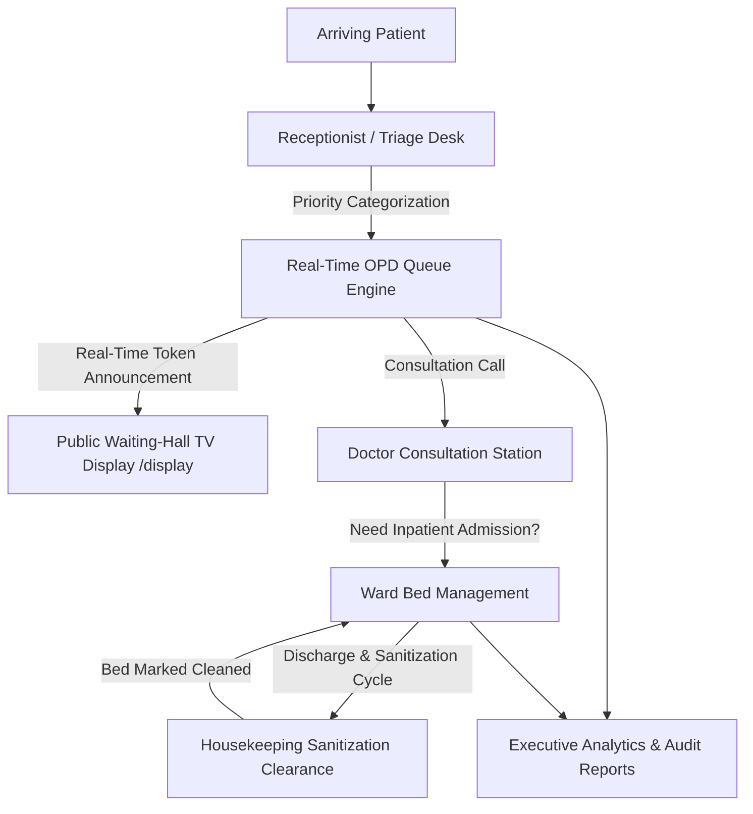
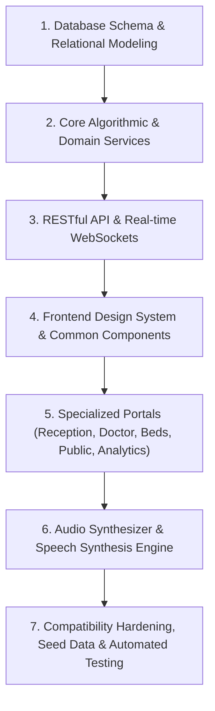
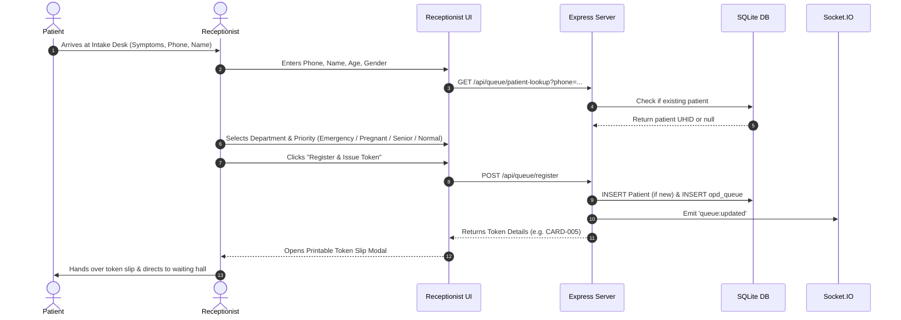
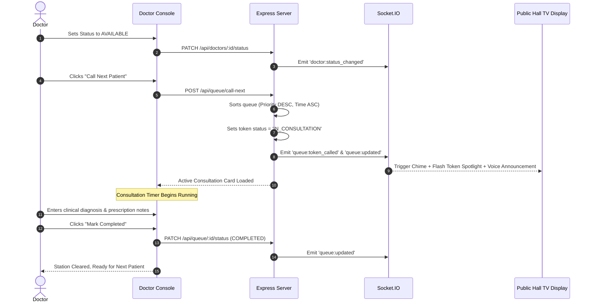
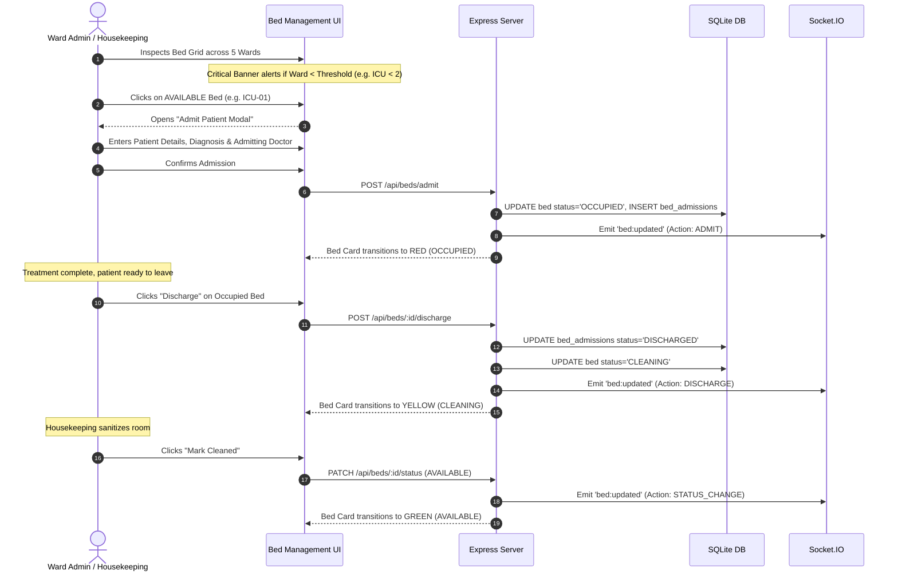
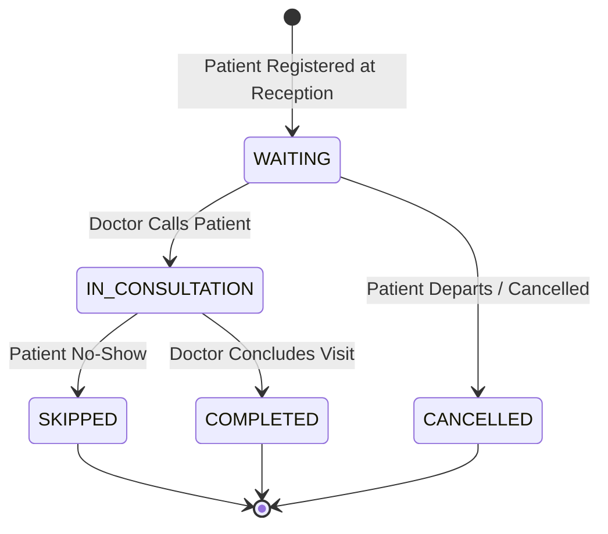
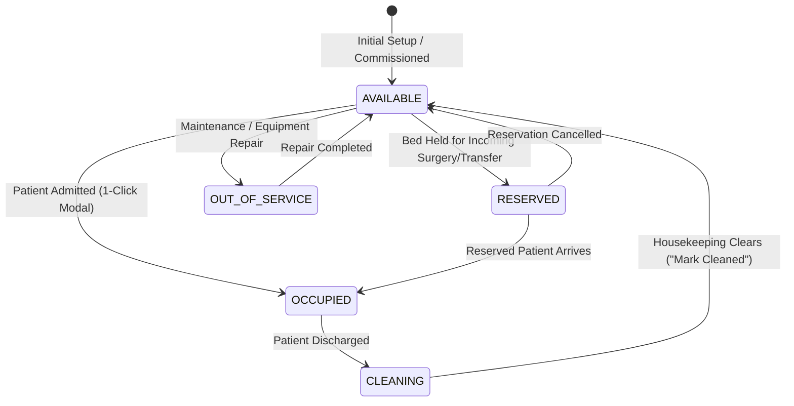
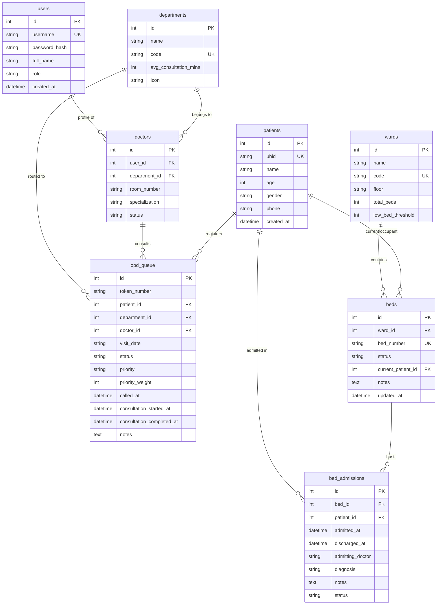

# CareSync: Comprehensive Implementation Plan, Architecture & System Workflow

> **Project Name:** CareSync — Hospital OPD Queuing & Bed Availability Tracker  
> **System Classification:** Real-Time Full-Stack Healthcare Operations Platform  
> **Repository Root:** `c:/project-fsd`  
> **Document Status:** Complete Production Architecture & Workflow Specification  

---

## Table of Contents
1. [Executive Summary & Problem Statement](#1-executive-summary--problem-statement)
2. [High-Level Architecture & Tech Stack](#2-high-level-architecture--tech-stack)
3. [The Workflow of Making: How It Was Engineered](#3-the-workflow-of-making-how-it-was-engineered)
4. [User Workflows: Role-by-Role Journeys](#4-user-workflows-role-by-role-journeys)
5. [Algorithms, Formulations & State Machines](#5-algorithms-formulations--state-machines)
6. [Database Schema & Entity-Relationship Model](#6-database-schema--entity-relationship-model)
7. [REST API & Real-Time Socket Specification](#7-rest-api--real-time-socket-specification)
8. [Codebase Organization & File Map](#8-codebase-organization--file-map)
9. [Verification, Testing & Operational Guide](#9-verification-testing--operational-guide)

---

## 1. Executive Summary & Problem Statement

### 1.1 The Operational Challenge
In multi-specialty hospitals and healthcare centers, two major operational bottlenecks cause waiting-room friction, patient distress, and clinician burnout:
1. **Unpredictable OPD Waiting Queues:** Patients arrive without structured prioritization. Routine appointments, vulnerable individuals (pregnant women, senior citizens), and acute emergencies are lumped into a single chaotic waiting hall. Patients have zero visibility into their queue position or estimated wait times, leading to reception desk crowding.
2. **Disconnected Ward Bed Management:** Receptionists, ER physicians, and triage nurses lack real-time visibility into inpatient bed occupancy. Beds vacated upon patient discharge remain idle due to uncoordinated sanitization cycles, while acute cases wait unnecessarily in corridors.

### 1.2 The CareSync Solution
**CareSync** is a unified, real-time hospital operations system designed to synchronize Outpatient Department (OPD) queue dispatching with inpatient ward bed allocation.



---

## 2. High-Level Architecture & Tech Stack

CareSync is structured with a layered architecture decoupling presentation, real-time event broadcasting, transactional business logic, and relational data storage.

```mermaid
graph LR
    subgraph ClientLayer ["Client Layer (React 18 + Vite)"]
        UI1[Reception Desk]
        UI2[Doctor Station]
        UI3[Bed Grid & Wards]
        UI4[Public Hall TV Screen]
        UI5[Analytics Dashboard]
    end

    subgraph TransportLayer ["Transport & API Layer"]
        HTTP[Express 4 REST API]
        WS[Socket.IO Server v4]
    end

    subgraph ServiceLayer ["Core Business Services"]
        Triage[Priority Triage Engine]
        Token[Daily Token Generator]
        WaitTime[Dynamic Wait-Time Calculator]
        BedState[Bed Sanitization Lifecycle]
    end

    subgraph DataLayer ["Data Storage Layer"]
        DB[(SQLite / Node.js 24 Native DatabaseSync)]
        WAL[WAL Mode & Foreign Keys]
    end

    ClientLayer <-->|REST Calls / JWT| HTTP
    ClientLayer <-->|Bi-directional WebSockets| WS
    HTTP --> ServiceLayer
    WS --> ClientLayer
    ServiceLayer --> DataLayer
```



### 2.1 Technology Stack Details

| Layer | Technology | Key Capabilities & Justifications |
|---|---|---|
| **Frontend Framework** | [React 18](https://react.dev/) + [Vite 5](https://vitejs.dev/) | Sub-second HMR development, component-driven UI, fast bundle rendering |
| **Styling & Design System** | [Tailwind CSS 3](https://tailwindcss.com/) | Curated clinical color tokens (Emerald, Indigo, Amber, Rose, Slate), responsive grid layouts, glassmorphism |
| **Client Routing & Auth** | [React Router 7](https://reactrouter.com/) | Protected routes, role-based access control, automatic redirects based on user permissions |
| **Icons & Visuals** | [Lucide React](https://lucide.dev/) | Medical and operational icons (`Activity`, `Bed`, `Clock`, `Stethoscope`, `Bell`, `ShieldAlert`) |
| **Data Visualization** | [Recharts 2](https://recharts.org/) | Responsive SVG charts (Donut charts for bed occupancy, Bar charts for department volumes) |
| **Real-Time Transport** | [Socket.IO Client & Server 4](https://socket.io/) | Millisecond-latency synchronization across doctor consoles, reception desks, and waiting-hall screens |
| **Audio & Speech Engine** | Web Audio API + Web Speech API | Client-side synthesized dual-tone chime (D5 &rarr; A5) and multi-lingual browser text-to-speech without external sound assets |
| **Backend Framework** | [Node.js](https://nodejs.org/) + [Express 4](https://expressjs.com/) | RESTful controller-service architecture, structured error handling, CORS headers, JSON middleware |
| **Database & ORM Layer** | [Node 24 Native SQLite (`node:sqlite`)](https://nodejs.org/api/sqlite.html) + `better-sqlite3` fallback | Zero-dependency high-throughput relational storage with Write-Ahead Logging (WAL) and foreign key integrity |
| **Security & Authentication** | [JWT (`jsonwebtoken`)](https://github.com/auth0/node-jsonwebtoken) + [Bcrypt.js](https://github.com/dcodeIO/bcrypt.js) | Stateless bearer token authentication, bcrypt password hashing, role-based authorization middleware |
| **Testing & Verification** | Node.js Test Runner (`node --test`) + [Puppeteer](https://pptr.dev/) | Unit test suites for queue prioritization and token generation, headless browser screenshot validation |

---

## 3. The Workflow of Making: How It Was Engineered

CareSync was built through a 7-stage engineering methodology:



### Stage 1: Database Schema & Relational Modeling
- Created [schema.sql](file:///c:/project-fsd/server/src/db/schema.sql) with ANSI SQL compatible with SQLite and portable to PostgreSQL.
- Formulated 8 tables with explicit relational constraints (`FOREIGN KEY`, `ON DELETE CASCADE`, `CHECK` constraints):
  - `users`: Staff credentials, roles (`RECEPTIONIST`, `DOCTOR`, `WARD_ADMIN`, `ADMIN`), hashed passwords.
  - `departments`: Medical specialties (Cardiology, Orthopedics, Pediatrics, General Medicine) with consultation durations and icons.
  - `doctors`: Linked to `users` and `departments`, room numbers, and real-time statuses (`AVAILABLE`, `ON_BREAK`, `OFF_DUTY`).
  - `patients`: Master demographic registry with unique Hospital Identifiers (`UHID-YYYY-XXXX`), age, gender, phone.
  - `opd_queue`: Daily token records with triage priority levels, timestamps, notes, and statuses.
  - `wards`: Inpatient units (ICU, Emergency, Maternity, etc.) with bed capacities and critical low-bed thresholds.
  - `beds`: Individual physical beds with foreign keys to wards and states (`AVAILABLE`, `OCCUPIED`, `CLEANING`, `RESERVED`, `OUT_OF_SERVICE`).
  - `bed_admissions`: Inpatient admission and discharge audit log with diagnosis, admitting physician, and timestamps.
- Added composite performance indexes:
  - `idx_opd_queue_dept_date` on `(department_id, visit_date)`
  - `idx_opd_queue_priority` on `(priority_weight DESC, created_at ASC)`
  - `idx_beds_ward` and `idx_beds_status`

### Stage 2: Core Algorithmic & Domain Services
- **Priority Triage Service ([queueService.js](file:///c:/project-fsd/server/src/services/queueService.js)):**
  - Built priority weight assignments: `EMERGENCY` (3), `PREGNANT` (2), `SENIOR_CITIZEN` (1), `NORMAL` (0).
  - Designed dual-criteria sorting: `priority_weight DESC`, followed by `created_at ASC` (First-Come, First-Served within identical priority).
  - Programmed dynamic estimated wait-time calculation accounting for current queue position, average consultation minutes, active consultation load, and doctor break buffers (+15 mins).
- **Daily Sequential Token Generator ([tokenService.js](file:///c:/project-fsd/server/src/services/tokenService.js)):**
  - Formatted department-specific token strings (e.g., `CARD-001`, `ORTH-002`, `PEDI-003`).
  - Ensured daily sequence resets per department using date-stamped database queries.

### Stage 3: RESTful API & Real-Time Socket Layer
- Developed modular Express controllers and route handlers:
  - [authController.js](file:///c:/project-fsd/server/src/controllers/authController.js): Secure login, JWT issuance, profile verification.
  - [queueController.js](file:///c:/project-fsd/server/src/controllers/queueController.js): Patient intake, token creation, doctor call-next, token recall, status updates (`IN_CONSULTATION`, `COMPLETED`, `SKIPPED`).
  - [bedController.js](file:///c:/project-fsd/server/src/controllers/bedController.js): Ward summaries, bed grid queries, patient admission, patient discharge, and sanitization clearance.
  - [doctorController.js](file:///c:/project-fsd/server/src/controllers/doctorController.js): Doctor roster, room mappings, availability status toggles.
  - [reportController.js](file:///c:/project-fsd/server/src/controllers/reportController.js): Real-time executive KPIs, hourly volume analytics, and RFC-compliant CSV audit export.
- Integrated [socketHandler.js](file:///c:/project-fsd/server/src/sockets/socketHandler.js) and attached the `io` instance to Express `app` so every database mutation broadcasts real-time events (`queue:token_called`, `queue:updated`, `bed:updated`, `doctor:status_changed`).

### Stage 4: Frontend Design System & Layout Architecture
- Configured [tailwind.config.js](file:///c:/project-fsd/client/tailwind.config.js) and [index.css](file:///c:/project-fsd/client/src/index.css) with a clean medical color palette.
- Built reusable layout components:
  - [Navbar.jsx](file:///c:/project-fsd/client/src/components/layout/Navbar.jsx): Responsive header with live connection badge, role switcher, user profile pill, and one-click access to the public display.
  - [ProtectedRoute.jsx](file:///c:/project-fsd/client/src/components/layout/ProtectedRoute.jsx): Enforces role-based permissions (`RECEPTIONIST`, `DOCTOR`, `WARD_ADMIN`, `ADMIN`).
- Implemented global state providers:
  - [AuthContext.jsx](file:///c:/project-fsd/client/src/context/AuthContext.jsx): Stores active user session, token in `localStorage`, and handles login/logout.
  - [SocketContext.jsx](file:///c:/project-fsd/client/src/context/SocketContext.jsx): Manages single WebSocket connection with auto-reconnection and event listeners.

### Stage 5: Specialized Portals & User Interfaces
- **Reception Desk ([ReceptionistPage.jsx](file:///c:/project-fsd/client/src/pages/ReceptionistPage.jsx)):** Quick intake form with phone auto-lookup, priority dropdown with colored badges, instant token modal ([TokenSlipModal.jsx](file:///c:/project-fsd/client/src/components/queue/TokenSlipModal.jsx)), and a live department queue table.
- **Doctor Consultation Station ([DoctorPage.jsx](file:///c:/project-fsd/client/src/pages/DoctorPage.jsx)):** Hero CTA "Call Next Patient", live consultation stopwatch timer, notes input, clinical actions ("Complete", "Recall Chime", "Skip"), and doctor availability toggle.
- **Ward & Bed Manager ([BedManagementPage.jsx](file:///c:/project-fsd/client/src/pages/BedManagementPage.jsx)):** Summary statistics, low-availability warning banners ([LowAvailabilityAlert.jsx](file:///c:/project-fsd/client/src/components/beds/LowAvailabilityAlert.jsx)), interactive 38-bed interactive cards ([BedCard.jsx](file:///c:/project-fsd/client/src/components/beds/BedCard.jsx)), and patient admission modal ([AdmitPatientModal.jsx](file:///c:/project-fsd/client/src/components/beds/AdmitPatientModal.jsx)).
- **Public TV Screen ([PublicDisplayPage.jsx](file:///c:/project-fsd/client/src/pages/PublicDisplayPage.jsx)):** High-contrast dark-mode interface with a pulsing "Now Calling" spotlight, dual-tone chime audio, browser voice synthesizer, 6-patient upcoming queue with live wait times, and a ward bed availability widget.
- **Analytics & Reporting ([AnalyticsPage.jsx](file:///c:/project-fsd/client/src/pages/AnalyticsPage.jsx)):** KPI metrics cards, Recharts visualizations, and 1-click CSV download.

### Stage 6: Audio Synthesizer & Speech Engine
- Engineered [audioChime.js](file:///c:/project-fsd/client/src/utils/audioChime.js) utilizing the native browser Web Audio API:
  - Produces an authentic hospital chime: D5 (587.33 Hz) transitioning to A5 (880.00 Hz) using smooth exponential gain ramps.
  - Zero external MP3/WAV dependencies; 100% reliable offline.
  - Combines with browser `window.speechSynthesis` for spoken token instructions (e.g., *"Token CARD-001, please proceed to Room 101"*).

### Stage 7: Compatibility Hardening & Validation
- **Node.js 24 SQLite Compatibility:** Refactored [database.js](file:///c:/project-fsd/server/src/config/database.js) to detect and use Node.js 24's built-in `node:sqlite` (`DatabaseSync`), bypassing native C++ node-gyp build dependencies on newer Node environments while maintaining seamless fallback to `better-sqlite3`.
- **Database Seeder ([seed.js](file:///c:/project-fsd/server/src/db/seed.js)):** Populated the database with 6 staff user accounts, 4 departments, 4 doctors with room numbers, realistic patient profiles, active OPD queue items, 5 hospital wards, and 38 beds across all operational states.
- **Automated Verification:** Added unit tests ([queueOrdering.test.js](file:///c:/project-fsd/server/tests/queueOrdering.test.js), [tokenService.test.js](file:///c:/project-fsd/server/tests/tokenService.test.js)) and end-to-end integration test ([e2eVerification.js](file:///c:/project-fsd/server/tests/e2eVerification.js)).

---

## 4. User Workflows: Role-by-Role Journeys

CareSync provides customized workflows tailored to each healthcare operational role:

### 4.1 Workflow 1: Receptionist / Triage Desk (`RECEPTIONIST`)


**Step-by-Step Experience:**
1. **Login:** Log in with `reception` / `hospital123` (or click the "Receptionist" demo button on the login screen).
2. **Patient Intake Form:** Enter the patient's full name, phone number, age, and gender. If the phone already exists in the system, demographic details auto-populate.
3. **Triage Classification:**
   - `EMERGENCY`: Patient is suffering from acute trauma, chest pain, or breathing distress. Instantly assigned Weight 3 and placed ahead of all normal and priority waiting patients.
   - `PREGNANT`: Expecting mothers. Assigned Weight 2 for expedited care.
   - `SENIOR_CITIZEN`: Elderly individuals (60+). Assigned Weight 1.
   - `NORMAL`: Standard routine consultation. Assigned Weight 0.
4. **Issue Token:** Click **"Register & Issue Token"**.
5. **Printable Token Slip Modal:** An official hospital token slip appears displaying the Token Number, Department, UHID, Patient Name, Estimated Wait Time, and Timestamp with a 1-click **"Print Slip"** option.
6. **Live Queue Monitoring:** The receptionist can view the active live queue table, search by patient name or token, filter by department, and track real-time queue states.

---

### 4.2 Workflow 2: Attending Doctor Station (`DOCTOR`)


**Step-by-Step Experience:**
1. **Login:** Log in as Dr. Rajesh Sharma (`dr.sharma` / `hospital123` &bull; Cardiology, Room 101).
2. **Doctor Status Switcher:** In the top header bar, switch between:
   - `AVAILABLE` (Active consultation station)
   - `ON_BREAK` (Broadcasts a break indicator and adds a 15-minute buffer to patient wait estimates)
   - `OFF_DUTY` (Inactivates station)
3. **Calling Patients:** The doctor console highlights the highest priority waiting patient. Click the prominent **"Call Next Patient"** button.
4. **Instant Hall Broadcast:** Calling a patient immediately triggers:
   - Dual-tone melodic chime on the public waiting hall monitor.
   - Synthesized voice announcement calling the patient and token number to the doctor's room.
   - Animated visual spotlight banner on the hall display.
5. **Active Consultation Interface:**
   - Displays patient UHID, Name, Age, Gender, Phone, and Priority reason.
   - Real-time elapsed consultation stopwatch counter.
   - Freeform clinical notes and prescription input area.
6. **Consultation Actions:**
   - **"Recall Chime"**: Re-pages the patient if they haven't entered the room.
   - **"Mark Completed"**: Concludes the visit, records completion timestamp and clinical notes, and frees the doctor.
   - **"Skip / No-Show"**: Moves absent patients out of the active consultation slot.

---

### 4.3 Workflow 3: Inpatient Bed & Ward Management (`WARD_ADMIN`)


**Step-by-Step Experience:**
1. **Login:** Log in with `wardadmin` / `hospital123`.
2. **Ward Overview & Low Bed Alerts:** View summary tiles for all 5 wards:
   - Intensive Care Unit (ICU)
   - Emergency & Trauma
   - General Inpatient Ward
   - Maternity Ward
   - Pediatric Ward
   - If any ward's available beds drop below its safety threshold (e.g., ICU &le; 2 beds), an urgent warning banner triggers with visual pulse badges.
3. **Admitting a Patient:**
   - Locate any **Available (Green)** or **Reserved (Blue)** bed card.
   - Click **"Admit Patient"**.
   - Input the patient name, age, gender, phone, diagnosis, and admitting physician.
   - Upon confirmation, the bed transitions to **Occupied (Red)** with admitted patient information displayed directly on the card.
4. **Discharging a Patient:**
   - Click **"Discharge Patient"** on an occupied bed.
   - The active admission record is closed with a discharge timestamp.
   - The bed **automatically transitions to the Cleaning (Yellow)** state. It cannot be accidentally assigned to a new patient before sanitization.
5. **Sanitization Clearance ("Mark Cleaned"):**
   - Housekeeping disinfects the bed and clears safety protocols.
   - Click **"Mark Cleaned"** on the card.
   - The bed transitions back to **Available (Green)**, ready for the next patient.

---

### 4.4 Workflow 4: Public Waiting-Hall TV Display (`/display`)
- **Zero Authentication Required:** Designed to run unattended 24/7 on wall-mounted smart TVs and waiting-hall monitors at [http://localhost:5173/display](http://localhost:5173/display).
- **High-Contrast Dark Theme:** Uses deep slate backgrounds (`#0f172a`) and bold clinical typography readable from 20+ feet away.
- **"Now Calling" Spotlight:**
  - When any doctor calls or recalls a patient, the screen displays a pulsing card showing the Token Number (e.g., `CARD-001`), Patient Name, Department, Doctor, and Assigned Room destination.
- **Audio Chime & Spoken Announcements:**
  - Plays a gentle dual-tone hospital chime (D5 &rarr; A5) using the Web Audio API.
  - Generates clear synthesized speech: *"Token CARD-001, please proceed to Room 101"*.
- **Upcoming In-Line Queue:** Displays the next 6 waiting patients with live dynamically calculated wait times (e.g., `~15 mins`, `Next in line`).
- **Live Inpatient Bed Availability Widget:** Displays a live sidebar showing available beds in critical wards (ICU, Emergency, General) so visiting families and emergency personnel have instant visibility into hospital capacity.

---

### 4.5 Workflow 5: Hospital Administrator & Executive Reporting (`ADMIN`)
1. **Login:** Log in with `admin` / `hospital123`.
2. **Executive KPI Cards:**
   - **Total Patients Registered Today**: Real-time counter of total OPD visits.
   - **Average Wait Time**: Average minutes from patient registration to doctor consultation.
   - **Completed Consultations**: Number of successfully concluded visits.
   - **Hospital-Wide Bed Occupancy**: Live percentage of occupied inpatient beds.
3. **Interactive Charts (Recharts):**
   - **Department Volume Breakdown:** Compares total visits vs. completed consultations across Cardiology, Orthopedics, Pediatrics, and General Medicine.
   - **Ward Bed Utilization:** Donut chart illustrating Occupied vs. Available vs. Cleaning beds across all wards.
   - **Hourly Patient Arrivals:** Bar chart displaying patient intake trends throughout the day.
4. **One-Click RFC-Compliant CSV Audit Export:**
   - Click **"Export CSV Audit Report"**.
   - Generates a timestamped CSV containing complete OPD visit logs (Tokens, UHID, Patient Demographics, Priorities, Timestamps, Clinical Notes) and Inpatient Bed Admission/Discharge audit records.

---

## 5. Algorithms, Formulations & State Machines

### 5.1 Triage Priority Weighting & Queue Sorting
Every arriving patient is classified into one of four priority tiers. The priority weight $W(p)$ is defined as:

$$W(p) = \begin{cases} 
3 & \text{if } p = \text{EMERGENCY} \\
2 & \text{if } p = \text{PREGNANT} \\
1 & \text{if } p = \text{SENIOR\_CITIZEN} \\
0 & \text{if } p = \text{NORMAL} 
\end{cases}$$

When sorting the active waiting queue for any department or doctor station, tokens are ordered by the composite key:

$$\text{SortOrder}(A, B) = \begin{cases} 
A \text{ before } B & \text{if } W(A) > W(B) \\
B \text{ before } A & \text{if } W(A) < W(B) \\
A \text{ before } B & \text{if } W(A) = W(B) \land T_{\text{reg}}(A) < T_{\text{reg}}(B) \\
B \text{ before } A & \text{otherwise}
\end{cases}$$

Where $T_{\text{reg}}$ is the registration timestamp (`created_at`). This guarantees that emergencies instantly jump to the front of the line, while identical priority levels strictly observe First-Come, First-Served (FCFS).

### 5.2 Dynamic Estimated Wait-Time Formulation
For a waiting patient at 0-indexed position $k$ in the sorted queue:

$$T_{\text{wait}}(k) = \left( k + L_{\text{active}} \right) \times T_{\text{dept}} + B_{\text{doctor}}$$

Where:
- $k$: Position in waiting queue ($0, 1, 2, \dots$)
- $L_{\text{active}}$: Active consultation load ($1$ if doctor currently has a patient `IN_CONSULTATION`, else $0$)
- $T_{\text{dept}}$: Department average consultation duration in minutes (e.g., 15 mins for Cardiology)
- $B_{\text{doctor}}$: Doctor availability buffer ($15\text{ mins}$ if doctor status is `ON_BREAK`, else $0\text{ mins}$)
- If doctor status is `OFF_DUTY`, the wait time displays `"Doctor Off Duty"`.

### 5.3 OPD Queue Item Lifecycle State Machine



### 5.4 Inpatient Bed Lifecycle State Machine



---

## 6. Database Schema & Entity-Relationship Model



---

## 7. REST API & Real-Time Socket Specification

### 7.1 REST API Endpoint Catalog

#### Authentication (`/api/auth`)
| Method | Endpoint | Auth | Purpose | Request Body |
|---|---|---|---|---|
| `POST` | `/api/auth/login` | Public | Authenticates staff and issues JWT | `{ "username": "...", "password": "..." }` |
| `GET` | `/api/auth/me` | Bearer Token | Returns current authenticated user | None |

#### OPD Queue Management (`/api/queue`)
| Method | Endpoint | Auth | Purpose | Payload / Params |
|---|---|---|---|---|
| `POST` | `/api/queue/register` | Protected | Registers patient & generates daily token | `{ "name", "phone", "age", "gender", "department_id", "priority", "doctor_id" }` |
| `GET` | `/api/queue/live` | Public | Retrieves sorted live queue with wait times | Query: `?department_id=...&date=...` |
| `POST` | `/api/queue/call-next` | Doctor/Admin | Calls next prioritized patient in line | `{ "doctor_id": 1, "department_id": 1 }` |
| `POST` | `/api/queue/call-token` | Doctor/Admin | Recalls / re-chimes a specific token | `{ "token_id": 5 }` |
| `PATCH` | `/api/queue/:id/status`| Protected | Updates token status & clinical notes | `{ "status": "COMPLETED", "notes": "..." }` |
| `GET` | `/api/queue/patient-lookup`| Protected| Finds patient demographics by phone | Query: `?phone=9876543210` |
| `GET` | `/api/queue/display-data`| Public | Data feed for public waiting hall | None |

#### Ward & Bed Management (`/api/beds`)
| Method | Endpoint | Auth | Purpose | Payload / Params |
|---|---|---|---|---|
| `GET` | `/api/beds/summary` | Public | Ward occupancy stats & low bed alerts | None |
| `GET` | `/api/beds/grid` | Public | Bed cards with active occupant info | Query: `?ward_id=...&status=...` |
| `POST` | `/api/beds/admit` | Protected | Admits patient to available bed | `{ "bed_id", "name", "phone", "diagnosis", "admitting_doctor" }` |
| `POST` | `/api/beds/:id/discharge` | Protected | Discharges patient & sets bed to CLEANING | `{ "notes": "Discharge notes" }` |
| `PATCH` | `/api/beds/:id/status`| Protected | Updates bed state (e.g., Mark Cleaned) | `{ "status": "AVAILABLE", "notes": "..." }` |

#### Doctors & Roster (`/api/doctors`)
| Method | Endpoint | Auth | Purpose | Payload / Params |
|---|---|---|---|---|
| `GET` | `/api/doctors` | Public | Roster of active doctors and rooms | Query: `?department_id=...` |
| `PATCH` | `/api/doctors/:id/status`| Doctor/Admin| Updates availability status | `{ "status": "AVAILABLE" \| "ON_BREAK" \| "OFF_DUTY" }` |

#### Analytics & Reports (`/api/reports`)
| Method | Endpoint | Auth | Purpose | Payload / Params |
|---|---|---|---|---|
| `GET` | `/api/reports/kpis` | Public | Executive KPIs (visits, wait times, etc.)| None |
| `GET` | `/api/reports/analytics` | Public | Recharts chart datasets | None |
| `GET` | `/api/reports/export-csv` | Protected | Downloads RFC-compliant CSV audit file | None |

### 7.2 Real-Time WebSocket Event Matrix

| Event Name | Direction | Trigger Condition | Payload Content | UI Action Taken |
|---|---|---|---|---|
| `queue:token_called` | Server &rarr; Client | Doctor clicks "Call Next" or "Recall Chime" | `{ token, patientName, roomNumber, departmentName, doctorName, timestamp }` | Plays melodic chime, speaks synthetic voice announcement, triggers pulsing spotlight on `/display` |
| `queue:updated` | Server &rarr; Client | Token issued, consultation started, completed, or skipped | `{ action, tokenNumber, departmentId }` | Automatically refreshes queue tables and wait times on Reception and Doctor screens |
| `doctor:status_changed`| Server &rarr; Client | Doctor toggles AVAILABLE / ON_BREAK / OFF_DUTY | `{ doctorId, status, departmentId }` | Updates doctor badge and recalculates patient wait time buffers |
| `bed:updated` | Server &rarr; Client | Patient admitted, discharged, or sanitized | `{ action: 'ADMIT'\|'DISCHARGE'\|'STATUS_CHANGE', bed, wardId }` | Updates bed card color, recalculates ward occupancy, triggers or dismisses low bed alerts |

---

## 8. Codebase Organization & File Map

```
c:/project-fsd/
│
├── package.json                         # Root project scripts (concurrent execution, install:all, seed, dev)
├── README.md                            # High-level overview and quick start instructions
├── PROJECT_IMPLEMENTATION_AND_WORKFLOW.md # (This File) Complete engineering & workflow blueprint
│
├── client/                              # Frontend React 18 Application (Vite + Tailwind CSS)
│   ├── package.json                     # Client dependencies (Lucide, Recharts, Socket.IO Client, Router)
│   ├── vite.config.js                   # Vite configuration with /api and /socket.io reverse proxies
│   ├── tailwind.config.js               # Clinical color palette, glassmorphism, and utility tokens
│   ├── index.html                       # HTML5 entry with Inter font typography
│   │
│   └── src/
│       ├── main.jsx                     # React root DOM mounting
│       ├── App.jsx                      # App router, role-based protection, navigation shell
│       ├── index.css                    # Core design system CSS utilities
│       │
│       ├── api/
│       │   └── client.js                # Axios/Fetch API wrapper with JWT Bearer token interceptor
│       │
│       ├── context/
│       │   ├── AuthContext.jsx          # Session state, login, logout, token caching in localStorage
│       │   └── SocketContext.jsx        # Persistent WebSocket connection provider with auto-reconnect
│       │
│       ├── utils/
│       │   └── audioChime.js            # Web Audio API dual-tone chime (D5-A5) & Web Speech synthesis
│       │
│       ├── components/
│       │   ├── layout/
│       │   │   ├── Navbar.jsx           # Global navigation bar with live status, user pill & role switcher
│       │   │   └── ProtectedRoute.jsx   # Role authorization wrapper
│       │   ├── queue/
│       │   │   └── TokenSlipModal.jsx   # Printable patient OPD token slip modal
│       │   └── beds/
│       │       ├── BedCard.jsx          # Interactive bed card with 5 color-coded states
│       │       ├── AdmitPatientModal.jsx # Direct 1-click inpatient admission modal
│       │       └── LowAvailabilityAlert.jsx # Visual warning banner for critical ward shortages
│       │
│       └── pages/
│           ├── Login.jsx                # Login screen with 1-click demo role accounts
│           ├── ReceptionistPage.jsx     # Patient registration, priority triage, token issuing
│           ├── DoctorPage.jsx           # Doctor consultation station with active timer & call CTA
│           ├── BedManagementPage.jsx    # 5-ward bed grid, admission, discharge & sanitization tracker
│           ├── PublicDisplayPage.jsx    # Fullscreen TV waiting hall screen with chime & voice
│           └── AnalyticsPage.jsx        # Executive KPIs, Recharts volume/occupancy & CSV export
│
├── server/                              # Backend Node.js / Express Application
│   ├── package.json                     # Server dependencies (Express, Socket.IO, JWT, Bcrypt)
│   ├── data/
│   │   └── hospital.db                  # SQLite database file with WAL mode enabled
│   │
│   ├── src/
│   │   ├── server.js                    # Express app creation, HTTP server, socket initialization, routes
│   │   │
│   │   ├── config/
│   │   │   └── database.js              # SQLite connection (Node 24 DatabaseSync + better-sqlite3 fallback)
│   │   │
│   │   ├── db/
│   │   │   ├── schema.sql               # 8-table relational DDL schema with indexes and check constraints
│   │   │   └── seed.js                  # Comprehensive database seeder (users, doctors, 38 beds, queue)
│   │   │
│   │   ├── middleware/
│   │   │   └── auth.js                  # JWT verification & role authorization middleware
│   │   │
│   │   ├── services/
│   │   │   ├── queueService.js          # Priority weighting, queue sorting, wait-time formula
│   │   │   └── tokenService.js          # Department daily token sequential generator
│   │   │
│   │   ├── sockets/
│   │   │   └── socketHandler.js         # Socket.IO room subscriptions & disconnect handler
│   │   │
│   │   ├── controllers/
│   │   │   ├── authController.js        # Authentication & profile endpoints
│   │   │   ├── queueController.js       # OPD intake, triage, call next, recall, status transitions
│   │   │   ├── bedController.js         # Ward stats, bed grid, admission, discharge, clean clearance
│   │   │   ├── doctorController.js      # Doctor roster, room mappings & availability toggling
│   │   │   └── reportController.js      # Executive KPI aggregation, Recharts metrics & CSV export
│   │   │
│   │   └── routes/
│   │       ├── authRoutes.js            # Auth route bindings
│   │       ├── queueRoutes.js           # Queue route bindings
│   │       ├── bedRoutes.js             # Bed route bindings
│   │       ├── doctorRoutes.js          # Doctor route bindings
│   │       ├── departmentRoutes.js      # Department catalog route bindings
│   │       └── reportRoutes.js          # Analytics and CSV export route bindings
│   │
│   ├── tests/
│   │   ├── queueOrdering.test.js        # Unit test suite: Priority triage weighting & sorting
│   │   ├── tokenService.test.js         # Unit test suite: Token formatting & daily sequences
│   │   └── e2eVerification.js           # Full-cycle integration & workflow test script
│   │
│   └── scripts/
│       ├── captureScreenshots.js        # Puppeteer script capturing screenshots of all pages
│       └── captureActiveDoctor.js       # Puppeteer script capturing active doctor consultation
│
└── screenshots/                         # Captured UI screenshots demonstrating every module
    ├── 01_login_page.png
    ├── 02_receptionist_token_issued.png
    ├── 02b_receptionist_live_table.png
    ├── 03_public_waiting_hall_display.png
    ├── 04_doctor_station_called.png
    ├── 04_doctor_station_active_consultation.png
    ├── 05_bed_grid_admitted.png
    ├── 06_bed_grid_discharged_cleaning.png
    └── 07_reports_analytics_dashboard.png
```

---

## 9. Verification, Testing & Operational Guide

### 9.1 Quick Start Commands (Windows PowerShell / CMD)

```powershell
# 1. Install all dependencies across root, server, and client
npm.cmd run install:all

# 2. Reset and seed database with realistic hospital data
npm.cmd run seed

# 3. Start both backend (Port 5000) and frontend (Port 5173) concurrently
npm.cmd run dev
```

### 9.2 Running Automated Tests

```powershell
# Run backend unit tests (Built-in Node.js Test Runner)
npm.cmd test

# Run end-to-end integration test verifying full patient cycle
node server/tests/e2eVerification.js
```

### 9.3 Default Demo Credentials

| Role | Username | Password | Purpose & Station |
|---|---|---|---|
| **Receptionist** | `reception` | `hospital123` | Patient intake, priority categorization, token slip printing |
| **Doctor (Cardiology)** | `dr.sharma` | `hospital123` | Dr. Rajesh Sharma &bull; Room 101 &bull; Active consultation CTA |
| **Doctor (Pediatrics)** | `dr.patel` | `hospital123` | Dr. Ananya Patel &bull; Room 104 &bull; Pediatric consultations |
| **Doctor (Orthopedics)**| `dr.khan` | `hospital123` | Dr. Tariq Khan &bull; Room 102 &bull; Orthopedic consultations |
| **Ward Staff** | `wardadmin` | `hospital123` | Marcus Vance &bull; 38 Beds, Admissions, Discharges, Sanitization |
| **Hospital Administrator** | `admin` | `hospital123` | Clara Reed &bull; Executive KPIs, Recharts & RFC-compliant CSV export |
| **Public TV Screen** | *No Login* | *N/A* | Direct access at `/display` |

---

*This concludes the comprehensive implementation plan, technical architecture, and operational workflow guide for CareSync.*
